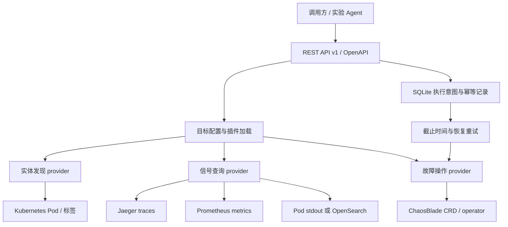

# 通过统一 API 访问微服务 demo

实现位置是 `demo_api/`，使用 Python 3.11+、FastAPI 和可替换 provider。运行时 HTTP 契约见 `/docs`、`/openapi.json`；仓库也保存了导出的 [OpenAPI](openapi.json)。新 demo 的接入要求见 [SPEC.md](SPEC.md)，目标配置可用 [JSON Schema](config.schema.json) 校验。

## 架构



一个 target 组合一个 discovery、每种 signal 一个 telemetry provider，以及可选 actuator。第三方 provider 通过 Python entry points 注册，API 路由与实验状态机不需要知道具体 demo 名称。既可以配置多个独立 target，也可以分别为新环境替换日志或故障后端。

当前内置 provider：Kubernetes discovery、Jaeger、Prometheus、Kubernetes stdout/stderr、OpenSearch、ChaosBlade。已经验证的目标是 otel-demo catalog；尚未验证第二个 demo 或非 Kubernetes discovery。

## 启动

以下命令均在 `impl` 目录执行。需要 `uv`、kubectl 和可访问的集群；部署还需要 Helm。使用 pip 时可用 `python3 -m pip install -e '.[test]'` 安装。

```bash
uv sync --extra test
# 当前 catalog 原始配置，无可查询的指标数据库：
uv run demo-api --config configs/otel-catalog.yaml
# 开启 Prometheus 后改用：
uv run demo-api --config configs/otel-catalog-metrics.yaml
```

两条启动命令择一运行。默认地址 `http://127.0.0.1:8000`，交互文档 `http://127.0.0.1:8000/docs`。同一 state 数据库只能由一个 API worker 使用，启动时以文件锁检查；不使用多 worker 或多副本共享本地 SQLite。

所有 `configs/otel-*.yaml` 默认指向 context `minikube`、namespace `otel-demo`。如果接入旧的 `default/my-otel-demo` 或新 profile，需要复制配置并修改 context/namespace，不能仅修改部署脚本环境变量。默认 `service_label: opentelemetry.io/name`，selector 是该标签存在；避免把 Collector 和存储组件当作应用故障目标。

如需远程使用，先设置 `DEMO_API_TOKEN`，再指定 `--host`。客户端请求带 `Authorization: Bearer $DEMO_API_TOKEN`。连接后端时默认按请求建立 localhost port-forward，结束即清理；进程内运行 API 时也不改变当前 kubectl context。已有网络可达 endpoint 时，provider 配置使用 `url` 可跳过转发。

## 为 catalog 启用指标

原始 catalog 将 metrics/logs 发给 debug exporter，不提供历史指标查询。此实现添加可选 overlay，使用 Prometheus 的 OTLP receiver 存储应用 metrics，不需要 OpenSearch：

```bash
OBSERVABILITY=1 bash otel-demo/demo.sh render catalog > /tmp/catalog-observability.yaml
OBSERVABILITY=1 bash otel-demo/demo.sh deploy catalog
uv run demo-api --config configs/otel-catalog-metrics.yaml
```

overlay 仅用于 catalog，增加一个 Prometheus Pod，并滚动更新 Collector；`otel-demo-prometheus` 这一资源名避免与机器上的已有 full release 的 Prometheus 重名。若在同一集群部署多套 catalog+metrics，仍需进一步区分其集群级 RBAC 资源名或使用独立 profile。Prometheus 未开启持久化，保留期限不等于重建后仍有数据。

`configs/otel-full.yaml` 组合官方 full 部署中的 Jaeger、Prometheus 与 Pod 日志。full 模式本机未完成整套端到端验证；指标名称按 demo 3.0.0 catalog 的实测配置，不代表每个 full 服务都产生该指标。需要 OTLP 持久化日志时将 logs provider 改为 opensearch，并按实际文档字段配置：

```yaml
logs:
  plugin: opensearch
  config:
    service: opensearch
    port: 9200
    index: otel-logs-*
    fields:
      timestamp: "@timestamp"
      service: resource.attributes.service.name.keyword
      body: body
      trace_id: trace_id
      severity: severity_text
```

上述是字段映射示例，接入时必须检查实际 index mapping 和文档；本机没有验证该 OpenSearch 管线。当前默认日志接口读取应用 stdout/stderr，与 Collector 接收到的 OTLP 日志是两种不同来源，capabilities 和 warnings 会说明这一点。

## 发现与查询

```bash
curl -s http://127.0.0.1:8000/v1/targets
curl -s http://127.0.0.1:8000/v1/targets/otel-demo/capabilities
curl -s http://127.0.0.1:8000/v1/targets/otel-demo/entities
curl -s http://127.0.0.1:8000/v1/targets/otel-demo/relations
```

使用动态时间窗查询，避免固定样例日期造成空结果：

```python
from datetime import datetime, timedelta, timezone
import httpx

now = datetime.now(timezone.utc)
body = {
    "signal": "metrics",   # 也可以选择 traces 或 logs
    "service": "product-catalog",
    "start": (now - timedelta(minutes=5)).isoformat(),
    "end": now.isoformat(),
    "metric": "rpc.calls", # metrics 必填，名称从 capabilities 中取得
    "limit": 20,
    "step_seconds": 15,
}
response = httpx.post(
    "http://127.0.0.1:8000/v1/targets/otel-demo/query", json=body, timeout=60, trust_env=False,
)
response.raise_for_status()
print(response.json())
```

`rpc.calls` 的单位为 calls，是 `rpc_server_call_duration_seconds_count` 按 job 聚合的累计调用计数，含 reflection 等所有被记录的 RPC，不是每秒请求数。空结果通常需要先产生业务请求，并等待应用指标导出；可使用原有 `demo.sh check catalog`。响应保留查询范围、数据来源、截断标记和限制说明。

## ChaosBlade 部署与动作

```bash
bash scripts/chaosblade.sh render > /tmp/chaosblade.yaml
bash scripts/chaosblade.sh install
bash scripts/chaosblade.sh status
```

脚本固定下载 operator v1.7.4 源码中的 chart，显式固定 operator/tool 镜像 1.7.4（上游该 tag 中 chart 版本仍是 1.7.3）。默认安装到 `chaosblade` namespace；webhook 关闭，保留节点 tool daemonset。支持 `PROFILE`、`CHAOS_NAMESPACE`、`HELM`、`TIMEOUT`。这是集群级工具，会创建 CRD、RBAC 和特权节点工具；API 的实验范围由目标配置固定，单次只选择一个应用 Pod。

当前动作：

| 动作 | 参数 | 恢复语义 | 本机验证 |
| --- | --- | --- | --- |
| pod.kill | 无 | 一次性删除；由 Deployment 等控制器重建，不能撤销删除 | 已实际成功、重建、清理并重新验收业务 |
| cpu.load | percent: 1..50，默认 20 | 删除实验资源后由 operator 恢复 | 尝试过；Docker API 版本不兼容，未生效 |
| network.delay | milliseconds: 1..3000，interface 默认 eth0 | 删除实验资源后由 operator 恢复 | 未实际注入，需兼容容器运行时 |

**本机 minikube 节点 Docker 29.2.1 的 API 下限为 1.44；ChaosBlade exec-cri 1.7.4 源码固定使用 1.24。** CPU 测试返回 `client version 1.24 is too old`。设置 tool 的 `DOCKER_API_VERSION` 无法解决该固定客户端版本；需要兼容的独立实验集群或修复后的 exec-cri 构建。此次没有修改节点 Docker 配置或放宽其 API 下限。Pod 删除走 Kubernetes API，不依赖该容器客户端，已经工作。网络动作依赖同类运行时调用，不应在未验证时视为可用。

预览不会产生故障：

```bash
curl -s -X POST http://127.0.0.1:8000/v1/targets/otel-demo/experiments \
  -H 'Content-Type: application/json' \
  -d '{"action":"pod.kill","service":"product-catalog","duration_seconds":10}'
```

实际执行会删除一个 Pod，应在可中断的实验环境操作：

```bash
curl -s -X POST http://127.0.0.1:8000/v1/targets/otel-demo/experiments \
  -H 'Content-Type: application/json' -H 'Idempotency-Key: example-pod-kill-001' \
  -d '{"action":"pod.kill","service":"product-catalog","duration_seconds":10,"dry_run":false}'
# 将返回的 da-... ID 替换到下方路径：
curl -s http://127.0.0.1:8000/v1/targets/otel-demo/experiments/da-REPLACE
curl -s -X DELETE http://127.0.0.1:8000/v1/targets/otel-demo/experiments/da-REPLACE
```

重试同一执行请求时使用同一幂等键；新实验使用新键。`pending` 只表示后端接受，需等待 `running` 并检查 `backend_status`。`cancelling` 不是恢复确认。失败的实验也需完成清理，再进行下一个实验。

恢复依赖运行中的 API reconciler 与 operator；API 崩溃时没有独立硬 TTL。保留 `.state/`，重启相同配置会恢复截止时间处理。需要在 API 停止后主动恢复所有未结束实验：

```bash
uv run python scripts/recover.py --config configs/otel-catalog-metrics.yaml
kubectl --context=minikube get chaosblades.chaosblade.io -l demo-api-target=otel-demo
```

不要删除持久化状态、手工移除 finalizer 或把旧 target ID 改指另一套部署来绕过未恢复记录。实验资源消失也不等于业务恢复，需要重新调用服务验证。

## 验证和扩展

```bash
uv run pytest -q
uv run python scripts/conformance.py --target otel-demo --service product-catalog \
  --require-records metrics traces
uv run python scripts/export_contract.py
```

conformance 默认只查询和预览，不实际注入。`--require-records logs` 可进一步要求日志非空，但安静服务在五分钟窗口内没有日志是合法情况。集成检查之前需启动 API 并产生业务流量。

同类 Kubernetes demo 首先复制 `configs/backend-template.yaml`，按实际情况填写 namespace/标签/endpoint/metric 模板即可。新增协议或基础设施时实现 `plugins.py` 中对应角色，在第三方包声明 `demo_api.providers` entry point。完整 agent 实现步骤、必须满足的语义和交付要求在 [SPEC.md](SPEC.md)。

## 生成整个目标系统的近期观测报告

提供了仅通过公共 HTTP 接口工作的 [完整样例](../examples/README.md)：自动发现全部 target 和服务，查询所有已公布指标、日志、traces 与近期实验，打印文本并生成离线 HTML 图形和 JSON 证据。

```bash
uv run python examples/system_overview.py --minutes 60 --output .reports/overview
# 浏览器打开 .reports/overview.html
```

图形区分服务/实例成员关系与 trace 中直接观察到的跨服务调用；报告保留空数据、后端错误、采样和截断说明。它不会执行故障，也不假定系统一定拥有某种指标。
